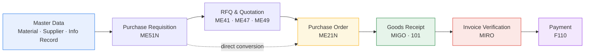
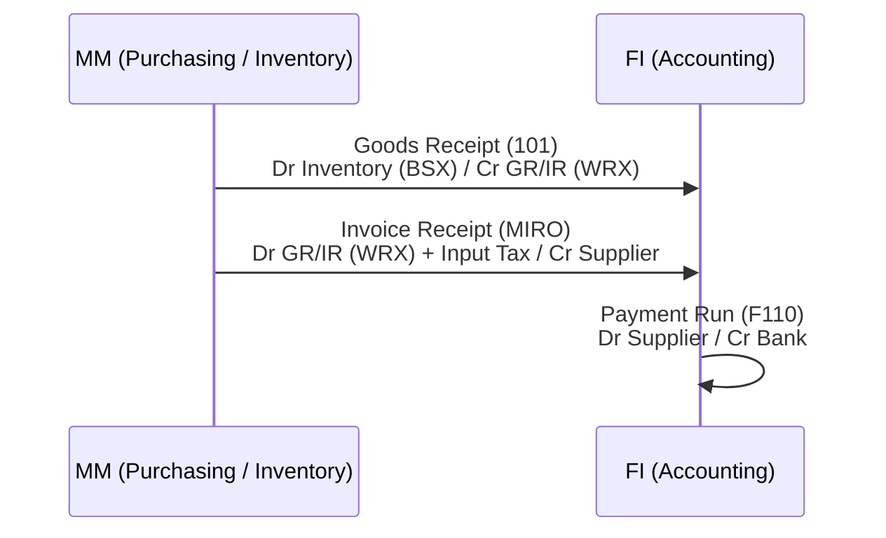

# SAP MM – Procure-to-Pay (P2P) End-to-End Guide

A practical, consultant-level walkthrough of the **Procure-to-Pay cycle in SAP MM**, covering both **SAP ECC** and **SAP S/4HANA**: process steps, transaction codes, Fiori apps, key tables, accounting entries and configuration points.

> Built as a reference for SAP MM consultants, key users and anyone preparing for an S/4HANA Sourcing & Procurement role.
> All examples use **dummy data** (company code `1000`, plant `1100`, etc.). No client data is included.

---

## The P2P Flow at a Glance

## Integration with Finance

---

## Contents

| # | Topic | What you'll find |
|---|-------|------------------|
| 01 | [Master Data](docs/01-master-data.md) | Material master, Business Partner, info records, source list |
| 02 | [Purchase Requisition](docs/02-purchase-requisition.md) | Manual & MRP-generated PRs, release strategy |
| 03 | [RFQ & Quotation](docs/03-rfq-quotation.md) | Sourcing, price comparison, S/4HANA RFQ apps |
| 04 | [Purchase Order](docs/04-purchase-order.md) | PO creation, release, output, reporting |
| 05 | [Goods Receipt](docs/05-goods-receipt.md) | Movement types, stock types, MATDOC |
| 06 | [Invoice Verification](docs/06-invoice-verification.md) | 3-way match, tolerances, blocked invoices |
| 07 | [Payment](docs/07-payment.md) | Automatic payment run, handover to FI |
| 08 | [Account Determination](docs/08-account-determination.md) | OBYC, valuation class, worked postings |
| 09 | [ECC vs S/4HANA Changes](docs/09-s4hana-changes.md) | Simplification items relevant to MM |
| — | [T-Code & Table Cheat Sheet](docs/cheat-sheet.md) | One-page quick reference |

---

## Skills Demonstrated

- End-to-end **Sourcing & Procurement** process design
- **SAP ECC → S/4HANA** functional differences (Business Partner, MATDOC, ACDOCA, Fiori)
- **MM–FI integration** and automatic account determination
- Release strategies, tolerance configuration and invoice blocking logic
- Process documentation for key-user training and blueprinting

## How to Use This Repo

- **Learning / interview prep:** read the docs in order (01 → 09).
- **On a project:** use the [cheat sheet](docs/cheat-sheet.md) and the config sections as a checklist.
- **Training key users:** the Mermaid diagrams render directly on GitHub and can be reused in slides.

> Fiori app names and availability vary by S/4HANA release and activated scope items. Always check the
> [SAP Fiori Apps Reference Library](https://fioriappslibrary.hana.ondemand.com) for your system.

## Roadmap

- [ ] Special procurement: subcontracting, consignment, stock transport orders
- [ ] Service procurement (lean services in S/4HANA)
- [ ] Scheduling agreements and contracts
- [ ] Sample test scripts for P2P UAT

## Author

**Manikanta Vootakuti** – SAP MM Consultant
Feedback and suggestions welcome via Issues.

## Disclaimer

SAP, SAP S/4HANA, SAP Fiori and other SAP products mentioned are trademarks of SAP SE. This is an independent educational project and is not affiliated with or endorsed by SAP.
