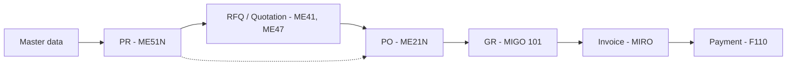

# sap-mm-procure-to-pay

My notes on the Procure-to-Pay cycle in SAP MM. I started putting these together while working through S/4HANA topics, mostly because I kept looking up the same T-codes, tables and OBYC keys again and again. Now it's all in one place.

Covers both ECC and S/4HANA where they differ. Everything here uses dummy data (company code 1000, plant 1100 etc.) - nothing from any client system.

## The flow

PR to PO directly is the normal case in most companies. RFQ only comes in when there's no fixed source or the buyer wants competing quotes.

## What's in here

- [01 - Master data](docs/01-master-data.md) - material master, BP, info records, source list
- [02 - Purchase requisition](docs/02-purchase-requisition.md) - incl. release strategy setup
- [03 - RFQ and quotation](docs/03-rfq-quotation.md)
- [04 - Purchase order](docs/04-purchase-order.md)
- [05 - Goods receipt](docs/05-goods-receipt.md) - movement types, MATDOC
- [06 - Invoice verification](docs/06-invoice-verification.md) - 3-way match, tolerances, blocks
- [07 - Payment](docs/07-payment.md) - the FI side, just enough to test end to end
- [08 - Account determination](docs/08-account-determination.md) - OBYC with a worked example
- [09 - ECC vs S/4HANA](docs/09-s4hana-changes.md) - what actually changes for MM
- [Cheat sheet](docs/cheat-sheet.md) - T-codes, tables, movement types on one page

If you're new to MM, read 01 to 08 in order. If you already know ECC and are moving to S/4, jump to 09 first.

A note on Fiori app names: they change between releases and depend on what's activated in your system, so check the Fiori Apps Reference Library before relying on any name I've listed.

## Still to add

- subcontracting, consignment, STO
- service procurement
- contracts and scheduling agreements
- a sample UAT test script for P2P

If something's wrong or missing, open an issue - happy to fix it.

*SAP, S/4HANA and Fiori are trademarks of SAP SE. This is a personal learning repo, not affiliated with SAP.*
