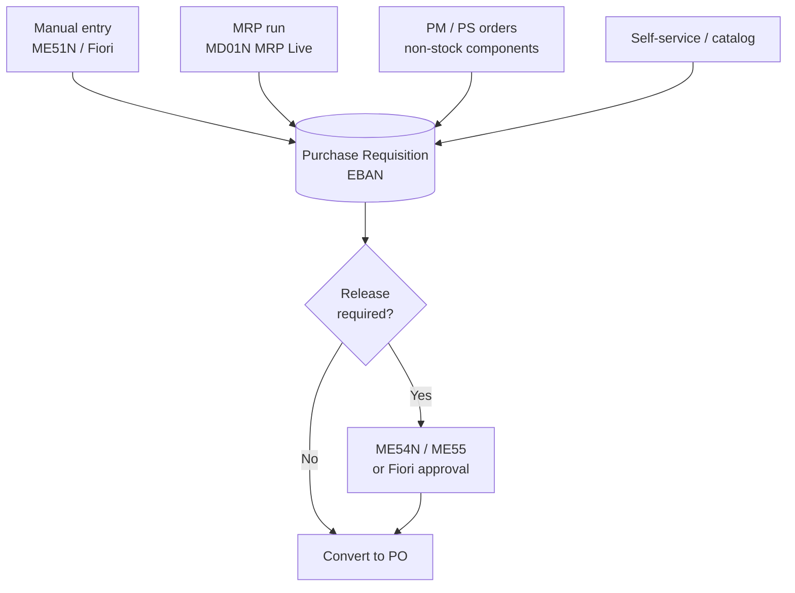

# 02 – Purchase Requisition (PR)

An internal request to procure a material or service. A PR is **not** sent to suppliers and has **no accounting impact**.

## Ways a PR is Created

## Transactions & Apps

| Action | ECC / GUI | Fiori (S/4HANA) |
|--------|-----------|-----------------|
| Create | `ME51N` | *Create Purchase Requisition* |
| Change / Display | `ME52N` / `ME53N` | *Manage Purchase Requisitions* |
| Release (individual) | `ME54N` | *My Inbox* (flexible workflow) |
| Release (collective) | `ME55` | *My Inbox* |
| List | `ME5A` | *Monitor Purchase Requisition Items* |
| Assign & convert to PO | `ME57` | *Manage Purchase Requisitions – Professional* |

**Tables:** `EBAN` (items) · `EBKN` (account assignment)

## Key Fields

- **Document type** (`NB` standard)
- **Item category** – blank (standard), `L` subcontracting, `K` consignment, `U` stock transfer, `D` service
- **Account assignment category** – blank (stock), `K` cost center, `F` order, `P` project, `A` asset
- Material / short text, quantity, delivery date, plant, purchasing group
- Desired supplier / fixed supplier, valuation price

## Release Strategy (Classic)

Classification-based release strategy:

1. Create characteristics (e.g. `CEBAN_GSWRT` total value, `CEBAN_WERKS` plant) – `CT04`
2. Create class of class type `032` – `CL02`
3. Configure release groups, release codes, release indicators, release strategies – SPRO → *MM → Purchasing → Purchase Requisition → Release Procedure → With Classification*
4. Assign values to strategy in classification

| Release indicator | Meaning |
|-------------------|---------|
| `X` | Blocked – no PO possible |
| `2` | Released – RFQ/PO possible |

> **S/4HANA:** *Flexible Workflow for Purchase Requisitions* is the recommended approach (configured via Fiori app *Manage Workflows for Purchase Requisitions*). Classic release strategy is still supported.

## Common Issues

| Symptom | Likely cause |
|---------|-------------|
| PR not converting to PO | Not released / no source of supply assigned |
| Release strategy not triggered | Characteristic values don't match, or class not assigned |
| MRP not creating PR | Wrong MRP type / procurement type `E` (in-house) instead of `F` |
