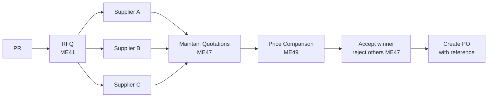

# 03 – RFQ & Quotation

Used when no fixed source exists or competitive bidding is required.

## Process

## Transactions & Apps

| Action | ECC / GUI | S/4HANA Fiori |
|--------|-----------|---------------|
| Create RFQ | `ME41` | *Manage RFQs* |
| Maintain quotation | `ME47` | *Manage Supplier Quotations* |
| Price comparison | `ME49` | *Compare Supplier Quotations* |
| Rejection letters | `ME4S` / output | – |

**Tables:** RFQs and quotations are stored in `EKKO` / `EKPO` with document category `EKKO-BSTYP = 'A'`.

| `BSTYP` | Document |
|---------|----------|
| `A` | RFQ / Quotation |
| `F` | Purchase Order |
| `K` | Contract |
| `L` | Scheduling Agreement |

## Notes

- One RFQ is created **per supplier** in classic MM; collective number (`SUBMI`) groups them for comparison.
- In S/4HANA, the new RFQ object can be sent to SAP Ariba Sourcing or the Ariba Network for supplier collaboration.
- Accepted quotation prices can update the info record (`ME47` → *Info update*).
