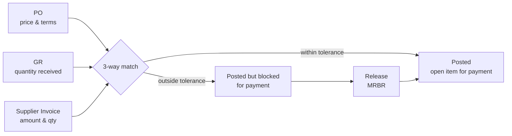

# 06 – Logistics Invoice Verification (LIV)

Matching the supplier invoice against the **PO** (price, terms) and the **GR** (quantity) – the classic **3-way match**.

## Transactions & Apps

| Action | ECC / GUI | S/4HANA Fiori |
|--------|-----------|---------------|
| Enter invoice | `MIRO` | *Create Supplier Invoice* |
| Park invoice | `MIR7` | *Create Supplier Invoice* (save as draft/park) |
| Display | `MIR4` | *Manage Supplier Invoices* |
| Release blocked invoices | `MRBR` | *Manage Supplier Invoices* |
| Cancel | `MR8M` | *Manage Supplier Invoices* |
| GR/IR maintenance | `MR11` | GR/IR reconciliation apps (*Monitor GR/IR Account Reconciliation*) |
| ERS (self-billing) | `MRRL` | *Evaluated Receipt Settlement* scheduling |

**Tables:** `RBKP` (header) · `RSEG` (item) · `RBCO` (account assignment) · accounting in `BKPF`/`ACDOCA`.

## Accounting Entry

| Dr/Cr | Account | Key |
|-------|---------|-----|
| Dr | GR/IR clearing | `WRX` |
| Dr | Input tax | `VST` |
| Dr/Cr | Price difference (if any) | `PRD` (price control S) or inventory `BSX` (price control V with stock coverage) |
| Cr | Supplier (reconciliation account) | from BP |

## Tolerance Keys (`OMR6`)

| Key | Checks |
|-----|--------|
| `PP` | Price variance |
| `DQ` | Quantity variance (invoice qty vs GR qty) |
| `DW` | Quantity variance when GR qty = 0 |
| `PS` | Price variance – estimated price |
| `ST` | Date variance (value × days) |
| `BD` | Small differences – automatic posting |
| `BR` / `BS` | Percentage OPUn variance |
| `AN` / `AP` | Amount for item without/with order reference |

## Blocking Reasons

| Indicator | Reason |
|-----------|--------|
| `R` | Blocked due to **price** |
| `M` | Blocked due to **quantity** |
| `D` | Blocked due to **date** |
| `I` | Blocked due to **quality inspection** |
| `S` | Stochastic (random) block |
| Manual | Item manually blocked during entry |

Blocked invoices get payment block `R` in the vendor line item and are released with `MRBR` (manually or automatically once the cause is resolved, e.g. after the missing GR is posted).

## GR/IR Clearing

Open GR/IR balances arise when quantities/values of GR and IR differ permanently (e.g. supplier will never send the remaining invoice). Clear with `MR11` and analyse regularly at period end – a key audit point.
