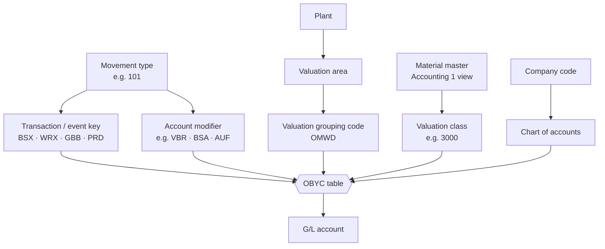

# 08 – Automatic Account Determination (MM–FI)

Every valuated goods movement and invoice finds its G/L accounts automatically. Configuration: **`OBYC`** (SPRO → *MM → Valuation and Account Assignment → Account Determination → Account Determination Without Wizard*).

## How the G/L Account Is Found

## Key Transaction Keys

| Key | Purpose | Typical use |
|-----|---------|-------------|
| `BSX` | Inventory posting | Stock account on GR/GI |
| `WRX` | GR/IR clearing | GR for PO, invoice |
| `GBB` | Offsetting entry for inventory | Consumption, scrapping, initial entry (with account modifiers `VBR`, `VNG`, `BSA`, `AUF`, …) |
| `PRD` | Price differences | Price control S; invoice variances |
| `KON` | Consignment liabilities | Consignment withdrawal |
| `FRL` / `FRN` | External service (subcontracting) | Subcontracting GR |
| `UMB` | Revaluation gain/loss | Price change in previous period |
| `KDM` | Exchange rate differences | Foreign currency invoices |

## Worked Example

**Setup:** raw material `RM-100`, valuation class `3000`, price control `S`, standard price **€10.00**.
PO: 100 PC at **€10.50** = €1,050. Invoice: 100 PC at €10.50.

**GR (mvt 101)**

| Dr/Cr | Key | Account | Amount |
|-------|-----|---------|--------|
| Dr | BSX | Raw material inventory | 1,000.00 |
| Dr | PRD | Price difference | 50.00 |
| Cr | WRX | GR/IR clearing | 1,050.00 |

**Invoice (MIRO)** – 19 % input tax

| Dr/Cr | Key | Account | Amount |
|-------|-----|---------|--------|
| Dr | WRX | GR/IR clearing | 1,050.00 |
| Dr | VST | Input tax | 199.50 |
| Cr | – | Supplier (recon. account) | 1,249.50 |

> With price control **V** (moving average), the €50 would go to `BSX` instead of `PRD` and increase the moving average price.

## Related Config

| Step | T-code |
|------|--------|
| Group valuation areas | `OMWD` |
| Valuation classes & account category references | `OMSK` |
| Account modifiers for movement types | `OMWN` |
| Account determination | `OBYC` |
| Simulate account determination | `OMWB` (simulation) |
